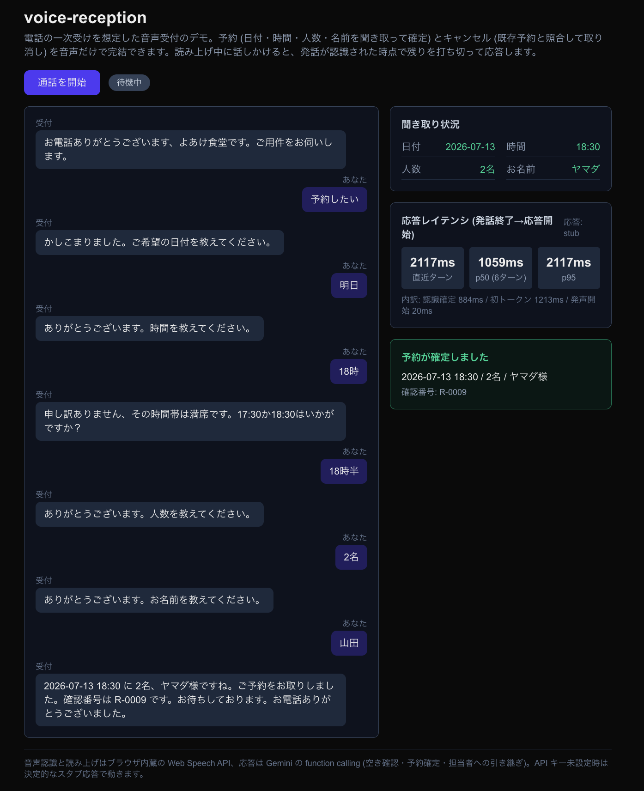
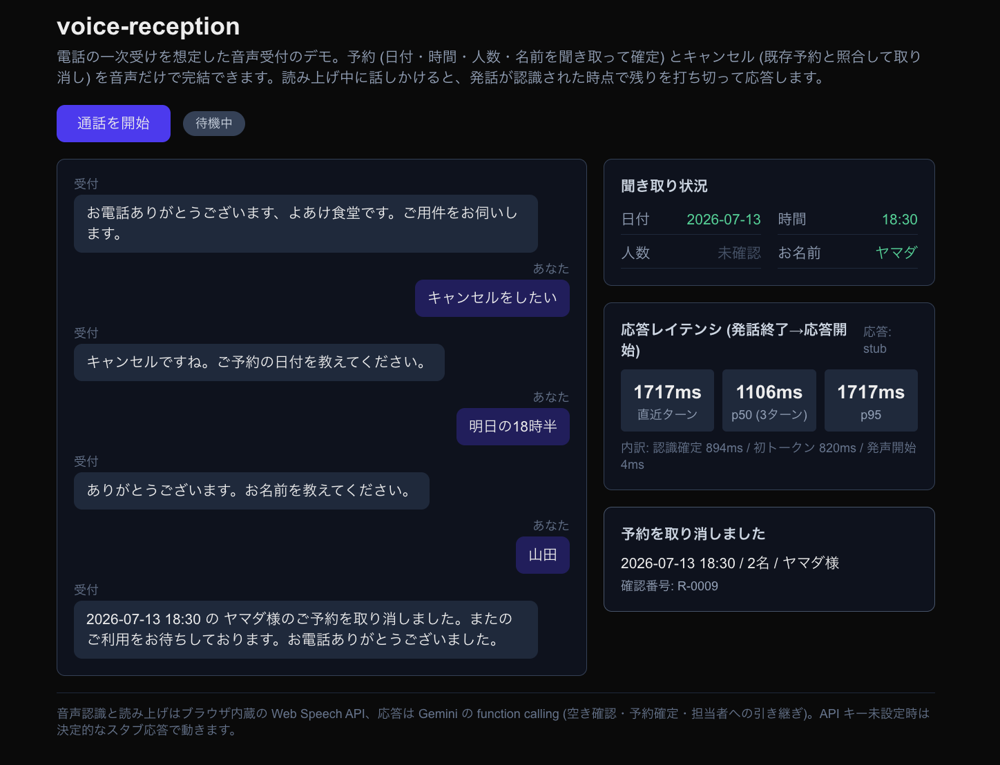

# voice-reception

電話の一次受けを想定した、ブラウザで動く音声予約受付のデモ。マイクに向かって話すと、レストランの受付として日付・時間・人数・名前を聞き取り、空き状況を確認して予約を確定する。読み上げ中に話しかけると、発話が認識された時点で残りを打ち切ってその発話に応答する (バージイン)。

## スクリーンショット



予約フロー。聞き取った項目は右上に反映され、満席の時間帯 (この例では 18:00) には近い空き時間を提案する。応答レイテンシ (発話終了→応答開始) は毎ターン計測して p50 / p95 と内訳を表示する。



キャンセルフロー。「明日の18時半」のように複数項目を一度に話しても聞き取り、日付・時間・名前で既存予約 (上の予約フローで確定した R-0009) を照合して取り消す。

## 何ができるか

- 音声だけで予約とキャンセルが完了する。聞き取れた項目は画面右の「聞き取り状況」に反映される
- 営業時間 (17:00〜21:30) の外は案内して断り、満席の時間帯 (各時間帯 3 組まで、デモでは 19:00 は常に満席) は近い順に空き時間を提案する。その日の全時間帯が満席なら別の日を促す
- キャンセルは日付・時間・名前を聞き取って既存予約と照合し、その場で取り消す
- 予約とキャンセル以外の用件 (予約内容の変更や問い合わせなど) は、担当者向けの引き継ぎ要約を作って人間へ渡す判定をする
- 用件が済んだら挨拶を言い切ってから自動で通話を終了する
- 「発話終了から応答開始まで」のレイテンシを毎ターン計測し、p50/p95 と区間内訳 (認識確定 / LLM 初トークン / 発声開始) を表示する

## 構成

```
ブラウザ
├─ 音声認識 / 読み上げ: Web Speech API (ブラウザ内蔵)
├─ 対話状態: listening → thinking → speaking の状態機械 (割り込みで listening に戻る)
└─ 応答文の文節分割: 文の区切りごとに読み上げを開始してレイテンシを削る

Next.js (API Route)
├─ /api/chat: Gemini に function calling で 6 つの道具を渡して受付をさせる (SSE)
│    update_reservation_state / check_availability / create_reservation
│    cancel_reservation / escalate_to_human / end_call
└─ /api/reservations: 予約一覧

Neon Postgres (予約の永続化。DATABASE_URL 未設定時はインメモリに切替)
```

スロットの検証 (日付形式・過去日付・人数 1〜12) と予約の確定はサーバー側で行い、LLM は会話に専念させる。予約確定はセッション ID の一意制約 (`ON CONFLICT DO NOTHING`) で冪等にしていて、二重送信されても同じ予約を返す。

## セットアップ

前提: Node.js 22、pnpm。Chrome 推奨 (音声認識が Web Speech API 依存のため)。

```sh
pnpm install
cp .env.example .env.local   # GEMINI_API_KEY と DATABASE_URL を設定
pnpm dev
```

`GEMINI_API_KEY` が未設定でも起動し、決定的なスタブ応答に切り替わる。`DATABASE_URL` (Neon) が未設定の場合はインメモリ保存になる (テーブルは初回アクセス時に自動作成)。スタブは日付・時刻・人数を正規表現で、用件をキーワードで判定する簡易版で、UI と音声ループの確認、CI での E2E に使う。予約外の用件を文脈から判断して引き継ぐのは Gemini モードのみ。

```sh
pnpm test        # vitest (状態機械・文節分割・レイテンシ計測・スロット検証・日本語パース・予約ストア)
pnpm typecheck
pnpm build
```

## デプロイ

Vercel にそのまま載る (ビルド設定はデフォルトのまま)。環境変数は 2 つ。

- `GEMINI_API_KEY`: 他のアプリと共用しない (無料枠は Google プロジェクト単位で消費されるため、共用すると別アプリの利用分で 429 になる)。未設定ならスタブ応答
- `DATABASE_URL`: Neon の接続文字列。serverless はインスタンス間でメモリを共有しないため、デプロイ時は必須 (未設定だと予約の照合が不安定になる)

## 設計メモ

- **なぜブラウザ完結か**: 電話網 (Twilio / SIP) は無料枠にクレジットカード登録が絡むため踏まない。音声の入出力層だけを差し替えれば電話接続に置き換えられる構成にしてある
- **なぜ外部の音声認識 / 合成サービスを使わないか**: Deepgram や ElevenLabs は品質面で優れるが、無料での恒久運用ができない。このデモの目的はパイプライン設計の実証なので、ブラウザ内蔵 API で成立させた
- **冪等性は DB の一意制約で担保**: 予約確定はセッション ID に UNIQUE 制約を張り `ON CONFLICT DO NOTHING` で挿入する。ネットワーク再送や二重送信が起きても予約は 1 件のままで、2 回目は既存の予約を返す。インメモリ実装 (開発・CI 用) も同じ振る舞いに揃えてある
- **割り込み (バージイン) は認識テキスト駆動**: 読み上げ中にユーザーの発話が認識されたら、残りの読み上げを破棄してその発話をそのまま処理する。音を止めるだけの割り込みはユーザーに言い直しを強いるため、「発話が反映されてターンが移る」ことを割り込みの成立条件にした。マイクの RMS を監視する音量ベースの VAD も実装したが、speechSynthesis の再生音はエコーキャンセルの参照信号にならず、スピーカー利用時の自己音声 (実測 RMS 0.08〜0.23) がユーザー発話 (同 0.3 前後) と重なって閾値では分離できないため撤去した。読み上げ開始から 600ms 以内に届く認識結果は直前の発話の遅延分とみなして無視する
- **エコー対策**: speechSynthesis の再生音はブラウザのエコーキャンセル対象外で、スピーカー利用時に自分の声として認識されてしまう。読み上げ中と直後 1.5 秒は認識結果を読み上げた文と 1 文ずつ文字照合 (bigram 重なり率 0.75) して自己音声を捨てる。連結比較にしないのは、丁寧語の語尾一致だけで本物の割り込み発話をエコー誤判定しないため
- **名前はカタカナの読みで扱う**: 電話では漢字表記を確認できないので、実際の電話受付と同じく名前は読み (カタカナ) として記録・復唱・照合する。音声認識は「やまだ」と言っても漢字 (山田) で返すことが多いため、かなの正規化に加えて、よくある姓 (約90件) の読み辞書で漢字も読みに変換する。辞書にない姓は漢字のまま残る制約があり、実モードでは Gemini がカタカナに直す。実運用でさらに固くするなら電話番号か予約番号での照合を足す
